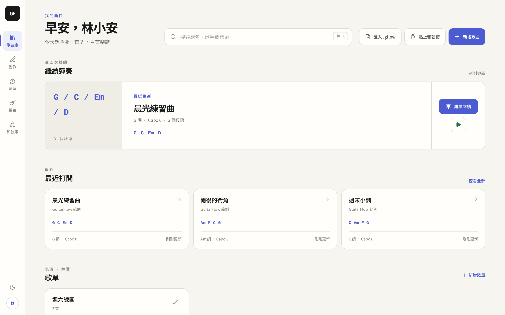
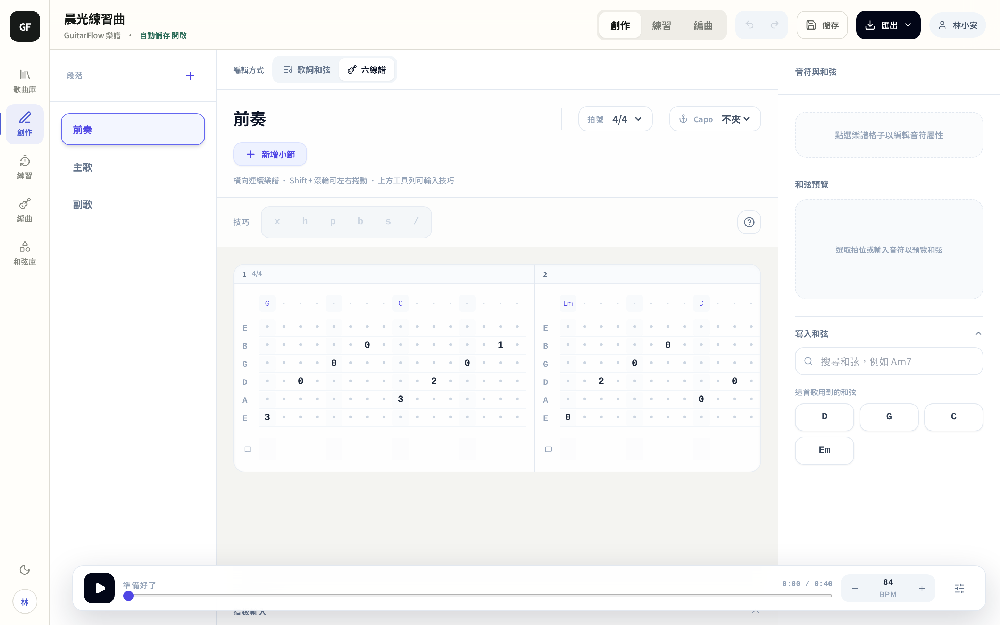
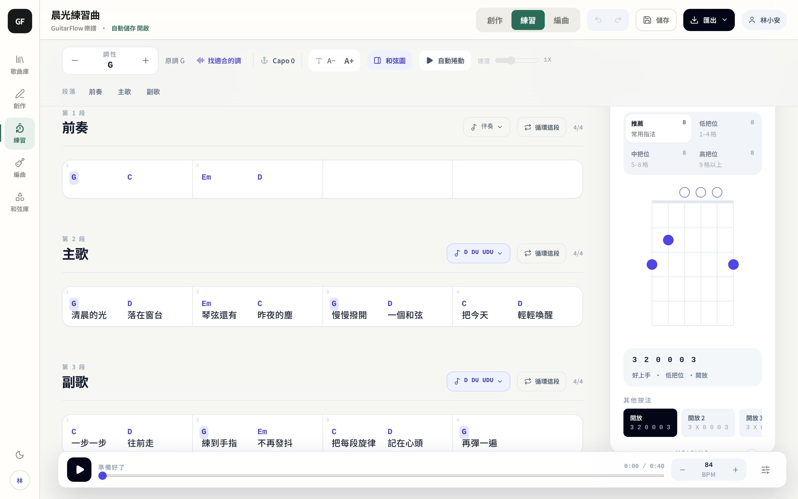
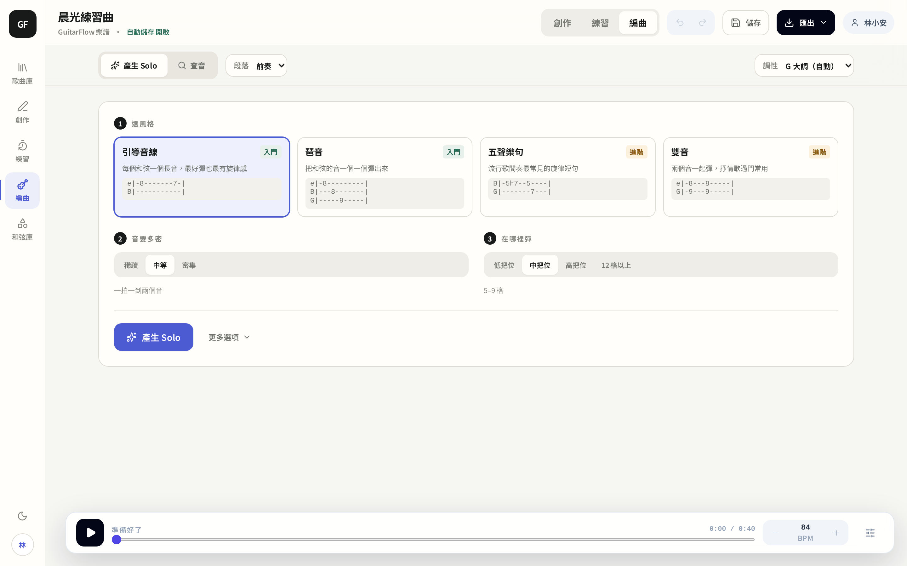
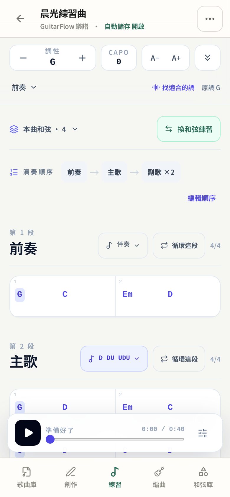
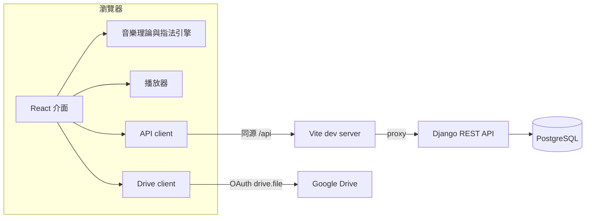

# GuitarFlow Studio

[](https://github.com/karevin07/guitarflow-studio/actions/workflows/ci.yml)
[](LICENSE)

網頁版吉他創作與練習工具：寫六線譜和歌詞、規劃整首歌的和弦指法、跟著節拍練習，並把歌曲存在自己的帳號裡。

React + TypeScript 前端負責編輯器、播放與音樂理論運算；Django REST Framework 後端負責帳號、權限與資料儲存。



## 畫面

| 創作 | 練習 |
| --- | --- |
|  |  |
| 六線譜與歌詞編輯、段落管理、和弦辨識、Undo/Redo、自動儲存 | 播放、節拍器、A–B 循環、轉調與 capo、整首歌的指法配置 |

| 編曲 | 手機 |
| --- | --- |
|  |  |
| 依調性與和弦進行產生單音 solo | 同一套介面在手機上改用底部導覽與精簡工具列 |

其他功能：搜尋、標籤、收藏、歌單與演奏順序；匯入 `.gflow`、貼上和弦譜；匯出 `.gflow`、MIDI、MusicXML；Google Drive 備份與還原。

## 架構



- 編輯、播放、和弦辨識與指法計算都在瀏覽器完成；後端只處理需要保存或需要權限的資料。
- 前端一律呼叫同源的 `/api`，由 Vite 轉給 Django。同一份程式不論從 localhost、區網或 SSH tunnel 開啟都不需要處理 CORS。
- 歌曲在前端是一個 `.gflow` JSON；後端拆成歌曲、段落、自訂和弦三張表，序列化器負責 snake_case 與 camelCase 的轉換。

## 設計重點

**自動儲存不會覆蓋曲庫的修改。** 編輯器每 30 秒自動送出整首歌，但歌手、原調、標籤、收藏這些曲庫資訊只能透過 `PATCH /songs/{id}/info/` 修改，完整更新會忽略它們。開著舊分頁自動儲存，也不會把剛在曲庫改好的資料改回去。
→ [`serializers.py`](backend/guitarflow/serializers.py)、[`views.py`](backend/guitarflow/views.py)

**巢狀資料用差異更新。** 儲存歌曲時比對既有段落與自訂和弦：既有項目就地更新並保留 ID，新的才新增，被移除的才刪除，整個過程包在一個資料庫交易裡。
→ [`GuitarSongSerializer.update`](backend/guitarflow/serializers.py)

**未確認登入前的操作會排隊。** 頁面剛載入時登入狀態還在確認，使用者這時選的檔案或按的按鈕會先排隊，確認登入後自動接著做；確定未登入才跳出登入框，登入後同樣會繼續。
→ [`App.tsx` 的 `runWhenSignedIn`](frontend/App.tsx)、[瀏覽器測試](frontend/e2e/core-flows.spec.ts)

**Google Drive 只在瀏覽器端串接。** 使用 Google Identity Services 取得 `drive.file` 權限，只能看到 GuitarFlow 自己建立的檔案；存取權杖只放在記憶體，後端不經手任何 Google 憑證。每個檔案以「歌曲 ID＋建立時間」對應歌曲，避免換到另一個資料庫時 ID 重複而覆蓋錯檔；整庫備份只上傳有變更的歌曲。
→ [`googleDrive.ts`](frontend/services/googleDrive.ts)、[`googleDriveBrowser.ts`](frontend/services/googleDriveBrowser.ts)

**指法由演算法產生並排序。** 和弦解析成音高集合後，以回溯搜尋列出指板上所有可行按法，再依跨度、把位、封閉和弦等條件評分；整首歌的指法配置則用動態規劃，兼顧每個按法的難度與換和弦時的移動距離，選出整體成本最低的組合。
→ [`music-theory/`](frontend/music-theory)、[`guitar/voicing/`](frontend/guitar/voicing)、[`voicingPlanner.ts`](frontend/services/voicingPlanner.ts)

**資料依帳號隔離。** 歌曲與歌單的 queryset 只回傳登入者自己的資料，歌曲另外以物件權限再檢查一次擁有者；拿別人的歌曲 ID 呼叫 API 一律回 404。
→ [`views.py`](backend/guitarflow/views.py)、[`permissions.py`](backend/guitarflow/permissions.py)

各項的細節與取捨見[設計說明](docs/DESIGN.md)。

## 測試

| 層級 | 工具 | 內容 |
| --- | --- | --- |
| 後端 | Django test | API、權限、資料驗證、差異更新 |
| 前端 | Vitest | 音樂理論、指法、播放時間、匯入匯出、Drive client |
| 端對端 | Playwright | 註冊與存檔、指法規劃、播放、手機版、登入前匯入 |

CI 在推送到 `main` 與 PR 時執行全部測試、型別檢查與建置；端對端測試跑在獨立的 Docker Compose 專案上，不會碰到日常使用的資料庫。

## 啟動

需要 Docker 與 Docker Compose：

```bash
make docker
```

開啟 <http://localhost:3003>。這是開發配置（Vite、Django 開發伺服器、預設資料庫密碼），不適合直接對外提供服務。

不用 Docker 時需要 Python 3.10+、[uv](https://docs.astral.sh/uv/) 與 Node.js 20.19+：

```bash
make install
make migrate
make dev-backend     # http://localhost:8000
make dev-frontend    # http://localhost:3000
```

```bash
make test            # 後端與前端單元測試
make help            # 其他指令
```

Google Drive 功能需要自己的 OAuth 用戶端 ID，設定方式見 [Google Drive 設定](docs/GOOGLE_DRIVE_SETUP.md)；沒設定時不會顯示相關按鈕。

## 專案結構

| 路徑 | 內容 |
| --- | --- |
| `frontend/components/` | 曲庫、創作、練習、編曲、和弦庫介面 |
| `frontend/hooks/` | 編輯狀態、播放、認證、自動儲存 |
| `frontend/services/` | API、匯入匯出、Drive、指法規劃 |
| `frontend/music-theory/`、`frontend/guitar/` | 音高、和弦、調性、指板與指法 |
| `frontend/e2e/` | Playwright 測試 |
| `backend/guitarflow/` | 模型、序列化器、API、權限、測試 |

## 文件

- [設計說明](docs/DESIGN.md)
- [專案架構](docs/PROJECT_OVERVIEW.md)
- [後端開發與 API](docs/BACKEND_DEVELOP.md)
- [前端路由](docs/FRONTEND_ROUTING.md)
- [Google Drive 設定](docs/GOOGLE_DRIVE_SETUP.md)
- [介面設計原則](docs/UI_GUIDELINES.md)
- [用 Tailscale 在其他裝置測試](docs/TAILSCALE_DOCKER_TESTING.md)
- [產品方向](docs/PRODUCT_ROADMAP_DESIGN.md)

## 授權

[MIT License](LICENSE)。第三方元件列於 [NOTICE](frontend/NOTICE.md)。
