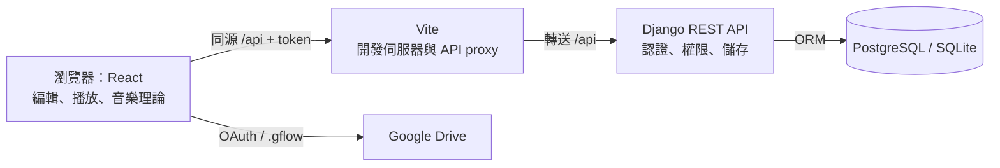

# GuitarFlow Studio

[](https://github.com/karevin07/guitarflow-studio/actions/workflows/ci.yml)
[](LICENSE)

在瀏覽器裡編輯六線譜和歌詞、規劃和弦指法，再播放歌曲練習。歌曲可以存在自己的帳號裡。


## 功能

| 創作 | 練習 |
| --- | --- |
|  |  |
| 六線譜、歌詞、段落編輯，和弦辨識與自動儲存 | 播放、節拍器、A–B 循環、轉調、capo 與指法配置 |

| 編曲 | 手機 |
| --- | --- |
|  |  |
| 依調性與和弦進行產生單音 solo | 底部導覽與精簡工具列 |

曲庫可以搜尋歌曲、加上標籤、標記收藏，或用歌單安排演奏順序。匯入時可開啟 `.gflow` 檔案或貼上和弦譜；匯出支援 `.gflow`、MIDI 和 MusicXML。歌曲也能備份到 Google Drive，之後再匯回曲庫。

## 架構



編輯、播放和指法計算都在瀏覽器裡完成，後端處理帳號與資料儲存。瀏覽器直接連到 Google Drive，不會把 Google 存取權杖送到後端。

- 歌曲採差異更新，保留既有段落 ID；整首歌的寫入包在同一個資料庫交易裡。
- 曲庫資訊透過獨立端點更新，編輯器儲存舊副本時不會把它蓋回去。
- 使用者只能讀寫自己的歌曲和歌單；請求其他使用者的資料 ID 時，API 回傳 404。

程式分工和資料關係整理在[專案架構](docs/PROJECT_OVERVIEW.md)，各項做法的理由則寫在[設計說明](docs/DESIGN.md)。

## 啟動

安裝 Docker 和 Docker Compose 後，在 repo 根目錄執行：

```bash
make docker
```

啟動後開啟 <http://localhost:3003>。這份 Compose 設定使用開發伺服器和預設資料庫密碼，供本機或私人網路使用。

不用 Docker 時，先安裝 Python 3.10+、[uv](https://docs.astral.sh/uv/) 和 Node.js 20.19+。若使用 Node.js 22，版本需為 22.12+：

```bash
make install
make migrate
make dev-backend     # 終端機 1：http://localhost:8000
make dev-frontend    # 終端機 2：http://localhost:3000
```

要使用 Google Drive，需另外設定 OAuth 用戶端 ID，做法見[設定步驟](docs/GOOGLE_DRIVE_SETUP.md)。沒有設定時，畫面會隱藏 Drive 按鈕。

## 測試

```bash
make test            # Django 與 Vitest
make format-frontend # TypeScript 型別檢查
make build           # 前端建置
make help            # 全部指令
```

CI 也會跑 Playwright 瀏覽器測試。本機執行時，使用獨立的測試資料庫：

```bash
docker compose --env-file .env.e2e.example -p guitarflow-e2e up -d --build --wait
cd frontend
npm ci
npx playwright install chromium
npm run test:e2e
cd ..
docker compose --env-file .env.e2e.example -p guitarflow-e2e down -v --remove-orphans
```

測試結束後，最後一行會移除測試專案的容器與資料庫 volume。

## 文件

- [專案架構](docs/PROJECT_OVERVIEW.md)與[設計說明](docs/DESIGN.md)
- [後端 API 與設定](docs/BACKEND_DEVELOP.md)、[前端路由](docs/FRONTEND_ROUTING.md)
- [Google Drive 設定](docs/GOOGLE_DRIVE_SETUP.md)
- [介面原則](docs/UI_GUIDELINES.md)、[功能範圍](docs/PRODUCT_ROADMAP_DESIGN.md)

## 授權

[MIT License](LICENSE)。第三方元件見 [NOTICE](frontend/NOTICE.md)。
