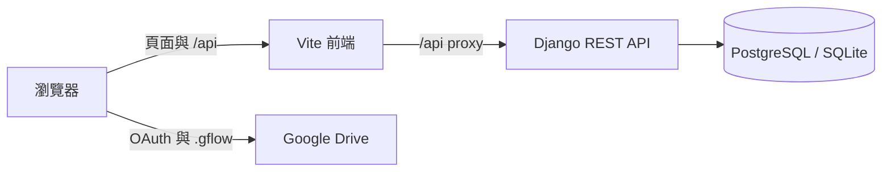
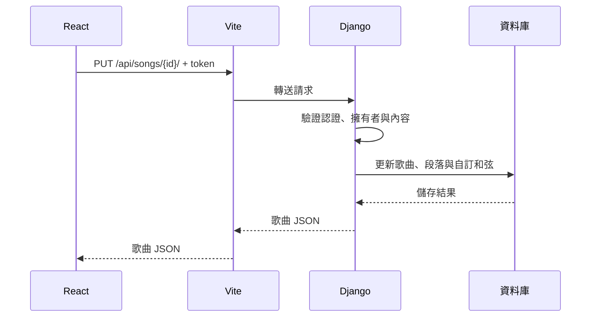

# 資料流程

## 開發服務

Docker 的前端入口為 `localhost:3003`。API 與 PostgreSQL 的主機 port 預設只綁在 loopback；前端透過容器網路連到 Django。

## 儲存歌曲

| 服務 | 啟動條件 | 健康檢查 |
| --- | --- | --- |
| PostgreSQL | 無 | `pg_isready` |
| Django | 資料庫健康 | `GET /api/global-chords/` |
| Vite | Django 健康 | Compose 未設定 |

程式目錄與儲存方式見[專案架構](PROJECT_OVERVIEW.md)。
