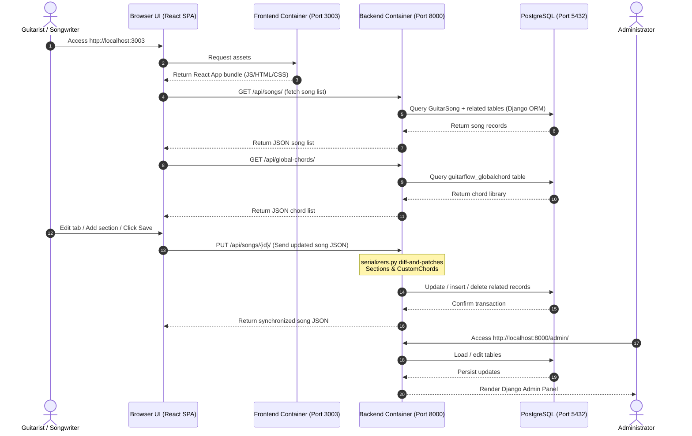
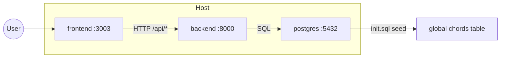

# GuitarFlow Studio Architecture & Structure Diagrams

This document contains visual diagrams mapping out the project's folder layout and its system architecture.

---

## 1. Directory Structure Chart

This graph visualizes the files and directories inside the workspace.

```mermaid
graph TD
    root["guitar-flow (Root)"]
    root --> compose["docker-compose.yml"]
    root --> makefile["Makefile"]
    root --> pginit["postgres-init/init.sql"]
    root --> readme["README.md"]
    root --> meta["metadata.json"]

    root --> frontendDir["frontend/"]
    frontendDir --> f_docker["Dockerfile"]
    frontendDir --> f_config["vite.config.ts"]
    frontendDir --> f_pkg["package.json"]
    frontendDir --> f_env[".env (VITE_API_URL)"]
    frontendDir --> f_src["App.tsx, index.tsx, types.ts"]
    frontendDir --> f_comp["components/ (TabMeasure, Fretboard, Home, etc.)"]
    frontendDir --> f_hooks["hooks/ (useEditorState, useSongLibrary)"]
    frontendDir --> f_serv["services/ (api.ts, midiHelper.ts)"]

    root --> backendDir["backend/"]
    backendDir --> b_docker["Dockerfile"]
    backendDir --> b_manage["manage.py"]
    backendDir --> b_toml["pyproject.toml"]
    backendDir --> b_core["core/ (Django Settings & Routing)"]
    backendDir --> b_app["guitarflow/ (Models, Serializers, Views, Tests)"]
```

---

## 2. System Architecture

This chart maps how the browser interacts with Docker containers and how data flows through Django REST Framework to PostgreSQL.

---

## 3. Docker Service Topology

| Service | Image | Depends On | Health Check |
| :--- | :--- | :--- | :--- |
| `db` | postgres:15-alpine | — | `pg_isready` |
| `backend` | guitar-flow-backend | `db` (healthy) | `GET /api/songs/` |
| `frontend` | guitar-flow-frontend | `backend` (healthy) | — |
