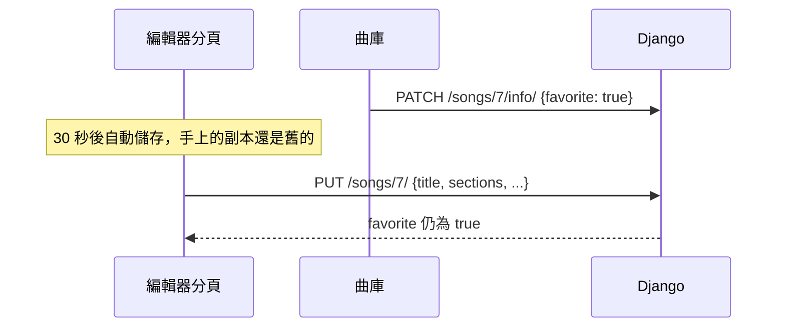

# 設計說明

這份文件說明 GuitarFlow 幾個前後端整合的做法，以及當初的取捨。功能與啟動方式見 [README](../README.md)。

## 1. 前後端分工

| 放在前端 | 放在後端 |
| --- | --- |
| 六線譜與歌詞編輯、Undo/Redo | 帳號與 token 認證 |
| 播放、節拍器、循環 | 歌曲、段落、自訂和弦、歌單的儲存 |
| 和弦解析、移調、調性分析 | 擁有者檢查與資料驗證 |
| 指法產生、評分與整首規劃 | 標準和弦表 |
| `.gflow`、MIDI、MusicXML 匯出；Google Drive | |

需要即時回應的運算都在瀏覽器完成，例如輸入一個音就重新辨識和弦、拖動 BPM 就重新排程播放。後端只在儲存與讀取時介入，所以 API 維持在一般的 CRUD 加上少數幾個專用端點。

前端一律呼叫同源的 `/api`，開發時由 Vite proxy 轉給 Django（[`vite.config.ts`](../frontend/vite.config.ts)）。proxy 保留瀏覽器送出的 `Host`，Django 的 `ALLOWED_HOSTS` 仍然對使用者實際開啟的網址生效。

## 2. 歌曲資料模型

前端把一首歌當成一份文件，也就是 `.gflow` 的格式：

```text
GuitarSong
├── title, bpm, transposeOffset, voicingPlan, form
├── sections[]   段落：capo、拍號、伴奏 pattern、measures / chords / lyrics
└── customChords[]
```

後端拆成 `GuitarSong`、`TabSection`、`CustomChord` 三張表。段落內的格線（`measures` 是「小節 × 弦 × 拍位」的三維陣列）直接存成 JSON：它永遠跟著段落一起讀寫，拆成更細的資料表只會增加查詢成本。

序列化器負責欄位名稱轉換（`transpose_offset` ↔ `transposeOffset`），所以 API 回傳的 JSON 與 `.gflow` 檔的結構幾乎相同，匯入匯出共用同一套驗證（[`gflowImport.ts`](../frontend/services/gflowImport.ts)、[`gflowExport.ts`](../frontend/services/gflowExport.ts)）。

## 3. 儲存與自動儲存

編輯器在內容變動後標記為未儲存，30 秒後自動送出 `PUT /songs/{id}/`（[`useAutosave.ts`](../frontend/hooks/useAutosave.ts)）；離開頁面前若還有未儲存的內容，瀏覽器會提示。

### 差異更新

`PUT` 送來的是整首歌，但後端不會把段落全部刪掉重建（[`serializers.py`](../backend/guitarflow/serializers.py)）：

1. 依 ID 對照既有段落：有的就地更新，沒有 ID 或找不到的才新增。
2. 這次沒送來的既有段落才刪除。
3. 自訂和弦以名稱對照，規則相同。

段落 ID 因此在多次儲存之間保持不變。三張表的寫入包在同一個資料庫交易裡，失敗時不會留下只存一半的歌曲。

### 曲庫資訊走獨立端點

歌手、原調、標籤、收藏與音域屬於「曲庫資訊」，只能透過 `PATCH /songs/{id}/info/` 修改；`PUT` 會忽略這些欄位。



如果自動儲存也會寫入這些欄位，開著的編輯器就可能用舊副本把剛改的收藏或標籤蓋回去。分開端點後，兩條寫入路徑不會互相覆蓋，也不需要額外的版本號或鎖。

## 4. 認證與等待中的操作

登入使用 DRF TokenAuthentication，token 存在 `localStorage`，每個請求帶 `Authorization: Token …`。

頁面載入後，前端要先呼叫 `/auth/me/` 才知道 token 是否仍有效。這段時間使用者可能已經選了要匯入的檔案。直接判斷「沒有使用者就跳登入框」會誤判，所以 [`App.tsx`](../frontend/App.tsx) 的 `runWhenSignedIn` 這樣處理：

- 已登入：立刻執行。
- 還在確認：把操作存起來，確認後自動執行。
- 確認未登入：開登入框，登入成功後執行同一個操作。

[`core-flows.spec.ts`](../frontend/e2e/core-flows.spec.ts) 分別以「延遲 `/auth/me/` 回應」與「未登入時選檔」驗證後兩種情況。

## 5. 資料隔離

- 歌曲與歌單的 queryset 只包含 `owner = 登入者` 的資料（[`views.py`](../backend/guitarflow/views.py)），別人的 ID 會得到 404，不會透露資料是否存在。
- 歌曲另外以 [`IsSongOwner`](../backend/guitarflow/permissions.py) 檢查物件擁有者，queryset 寫錯時還有一層保護。
- 新增時一律由後端指定擁有者，不接受前端傳入的 owner。
- 除了註冊與登入，標準和弦表是唯一不需登入的 API。

## 6. 指法引擎

和弦相關的運算都是前端的純函式，與 React 無關，各自有單元測試。

1. **解析**（[`music-theory/chord.ts`](../frontend/music-theory/chord.ts)）：把 `F#m7/E` 解析成根音、和弦性質與低音，轉成 0–11 的音高集合；移調與轉調都在音高上計算，再依調性選擇升降記號。
2. **產生**（[`guitar/voicing/generator.ts`](../frontend/guitar/voicing/generator.ts)）：對六條弦做回溯搜尋，每條弦可以不彈或按某一格；跨度超過限制、或缺少必要和弦音時提早剪枝。
3. **評分**（[`guitar/voicing/scorer.ts`](../frontend/guitar/voicing/scorer.ts)）：依跨度、把位、是否封閉和弦、空弦數量等條件標記與排序。常用和弦優先使用人工整理的按法，產生的結果作為補充。
4. **整首規劃**（[`services/voicingPlanner.ts`](../frontend/services/voicingPlanner.ts)）：把和弦進行當成序列，每個和弦有數個候選按法。以動態規劃計算「按法本身的難度＋與前一個按法的移動距離」的總成本，回溯出最低成本的組合。使用者鎖定的按法會保留，不被重新規劃。

## 7. Google Drive

Drive 串接完全在瀏覽器端（[`googleDrive.ts`](../frontend/services/googleDrive.ts)、[`googleDriveBrowser.ts`](../frontend/services/googleDriveBrowser.ts)）：

- **權限**：只要求 `drive.file`，只能看到 GuitarFlow 自己建立的檔案，屬於不需 Google 安全審查的非敏感權限。
- **權杖**：Google Identity Services 的 token 模式只需要 OAuth 用戶端 ID；存取權杖只存在記憶體，後端不保存任何 Google 憑證。
- **對應歌曲**：每個檔案在 `appProperties` 記錄「歌曲 ID＋建立時間」。只用 ID 不夠，因為不同資料庫的 ID 都從 1 開始，換到新環境時會覆蓋到另一首歌的檔案。
- **整庫備份**：先列出 Drive 上所有 GuitarFlow 檔案，比較修改時間，只上傳有變更的歌曲；單首失敗會記錄後繼續，權限失效則整批停止。
- **還原**：從 Drive 匯入時，把檔案改綁到新建立的歌曲，之後再備份會覆蓋原檔，而不是多出一份。

REST 呼叫與瀏覽器登入分在兩個檔案，前者接受注入的 `fetch` 與 token 來源，可以不開瀏覽器直接測試。

## 8. 測試策略

| 層級 | 位置 | 重點 |
| --- | --- | --- |
| 後端 | `backend/guitarflow/tests.py` | API 契約、權限、驗證、差異更新保留 ID |
| 前端單元 | `frontend/**/*.test.ts` | 音樂理論、指法、播放時間換算、匯入匯出、Drive client |
| 端對端 | `frontend/e2e/` | 註冊與存檔、指法規劃、播放、手機版、登入前匯入 |

端對端測試透過 `.env.e2e.example` 啟動獨立的 Compose 專案（不同 port 與 volume），CI 與本機都用同一套設定，不會寫入日常使用的資料庫（[`ci.yml`](../.github/workflows/ci.yml)）。

## 9. 目前的限制

- Compose 跑的是 Vite 與 Django 開發伺服器，適合本機或內網使用。對外部署還需要正式的應用伺服器、HTTPS、靜態檔案服務與資料庫備份。
- token 存在 `localStorage`，登入與註冊端點沒有流量限制；公開服務前應重新評估認證方式。
- 六線譜使用固定格線（每小節 16 格），不記錄音符時值。改成時值模型會影響編輯、播放與匯出，列在[產品方向](PRODUCT_ROADMAP_DESIGN.md)中評估。
