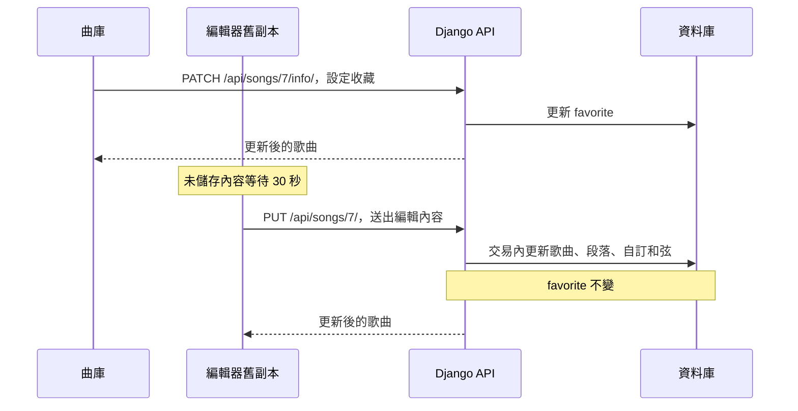
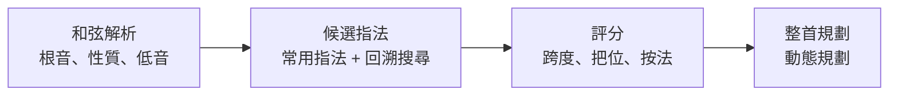

# 設計說明

以下說明資料如何儲存、登入前的操作怎麼處理，以及指法如何計算。服務與資料的關係整理在[專案架構](PROJECT_OVERVIEW.md)。

## 儲存歌曲

前端把一首歌當成一份 `.gflow` JSON，後端則分成歌曲、段落和自訂和弦儲存。格線資料跟著段落一起讀寫，因此直接存成 JSON。序列化器負責在 snake_case 與 camelCase 之間轉換欄位名稱。

新增或更新歌曲時，所有寫入都包在同一個資料庫交易裡，失敗就整筆回滾。更新規則如下：

- 段落依 ID 比對，更新原有段落並保留 ID。
- 自訂和弦依名稱比對，新增項目，刪除這次沒有送來的項目。

實作見 [serializers.py](../backend/guitarflow/serializers.py)。

## 自動儲存與曲庫資訊

開啟自動儲存後，未儲存的編輯內容會先等待 30 秒，再以 `PUT /api/songs/{id}/` 送出。歌手、原調、標籤、收藏與音域則透過 `PATCH /api/songs/{id}/info/` 更新，送出整首歌時不會修改這些欄位。

因此，編輯器手上的舊副本不會蓋掉剛在曲庫改好的資訊。不過，兩個編輯器分頁若同時修改譜面，仍以最後寫入的內容為準，不會合併版本衝突。

實作見 [useAutosave.ts](../frontend/hooks/useAutosave.ts)、[serializers.py](../backend/guitarflow/serializers.py)。

## 登入與資料隔離

Django 使用 TokenAuthentication。前端把 token 存在 `localStorage`，發送請求時帶上 `Authorization: Token <token>`。

`App.tsx` 的 `runWhenSignedIn` 處理需要登入的操作：

- 已登入：立即執行。
- 正在確認登入狀態：保留操作，等待 `/api/auth/me/` 回應。
- 未登入：開啟登入框，成功後繼續原操作；關閉則取消。

目前只保留一個等待中的操作，後來的操作會取代前一個。

歌曲與歌單的 queryset 只查詢目前使用者的資料，歌曲另外再做一次物件權限檢查。新增時由後端指定 owner；請求別人的資料 ID，API 會回傳 404。註冊、登入和全域和弦 API 不需要登入。

實作見 [App.tsx](../frontend/App.tsx)、[views.py](../backend/guitarflow/views.py)、[permissions.py](../backend/guitarflow/permissions.py)。

## 指法規劃

搜尋會排除跨度過大或缺少必要音的指法。規劃整首歌時，會把按法難度和換和弦的移動成本一起計算，從候選組合中選出總成本最低的路徑。使用者鎖定的指法會保留。

這些運算是前端純函式，不依賴 React。實作見 [chord.ts](../frontend/music-theory/chord.ts)、[generator.ts](../frontend/guitar/voicing/generator.ts)、[scorer.ts](../frontend/guitar/voicing/scorer.ts)、[voicingPlanner.ts](../frontend/services/voicingPlanner.ts)。

## Google Drive

瀏覽器透過 Google Identity Services 取得 `drive.file` 權限，Google token 只留在記憶體裡。Django 不會接收 Google 憑證。

檔案的 `appProperties` 用「歌曲 ID＋建立時間」識別歌曲，避免換到另一個資料庫後，因為 ID 重複而覆蓋錯檔。備份整個曲庫時會比較修改時間，只上傳有變更的歌曲；還原後，檔案會改綁到新建立的歌曲。

Drive REST client 可以替換 `fetch` 和 token 來源，所以單元測試不需要 Google 帳號。實作見 [googleDrive.ts](../frontend/services/googleDrive.ts)，使用方式見[設定文件](GOOGLE_DRIVE_SETUP.md)。

## 測試與限制

| 層級 | 範圍 |
| --- | --- |
| Django | API、權限、資料驗證與差異更新 |
| Vitest | 音樂理論、指法、播放、檔案與 Drive client |
| Playwright | 登入、存檔、播放、匯入與手機操作 |

瀏覽器測試使用獨立 Compose 專案，操作指令見 [README](../README.md#測試)。

目前使用開發伺服器與固定格線記譜（每小節 16 格）。登入 token 存在 `localStorage`，登入與註冊端點未設定流量限制。
