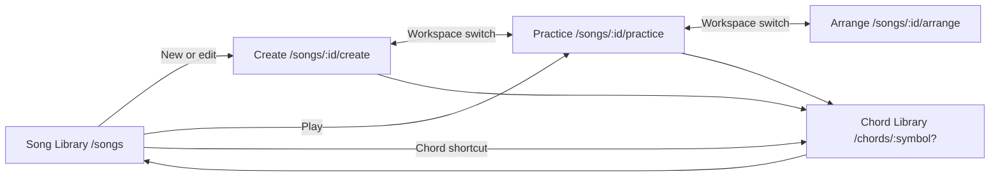

# Frontend Routing Architecture

## Overview

GuitarFlow uses React Router in declarative browser-history mode. URLs identify the user's workspace and selected resource; editor, playback, authentication, and library data remain managed by the existing hooks in `App.tsx`.

The product has three primary feature pages—Create, Practice, and Chord Library—plus the Song Library entry page. GuitarFlow songs also have an Arrange workspace for single-note solo suggestions.

## Route Map

| URL | Page | Authentication | Notes |
|---|---|---|---|
| `/` | Redirect target | No | Canonicalized to `/songs` |
| `/songs` | Song Library | Optional | Guests can browse the shell and sign in |
| `/songs/:songId/create` | Create | Required | |
| `/songs/:songId/practice` | Practice | Required | |
| `/songs/:songId/arrange` | Arrange | Required | |
| `/chords` | Chord Library | No | Opens the default recommended chord |
| `/chords/:symbol` | Chord detail | No | Example: `/chords/F%23m7` |
| Any unknown URL | Fallback | No | Replaced with `/songs` |

Route construction and parsing are centralized in `frontend/services/routes.ts`. UI code should use `appPaths` rather than assembling URL strings.

## Key Components

- **`BrowserRouter`**: Owns browser history and enables back/forward navigation.
- **`App.tsx`**: Resolves the current route, loads the requested song, and connects route state to existing application hooks.
- **`AppRail`**: Provides the five user-facing destinations: Song Library, Create, Practice, Arrange, and Chord Library. Outside a song, Create, Practice, and Arrange open the most recently opened song in that workspace.
- **`SongShellHeader`**: Switches between Create, Practice, and Arrange for the currently loaded song.
- **Route helpers**: Parse, encode, and test application URLs without coupling components to URL syntax.

## Navigation Flow



## Route State Model

The URL is authoritative for page identity and resource identity:

```ts
type AppRoute =
  | { name: 'songs' }
  | { name: 'create'; songId: string }
  | { name: 'practice'; songId: string }
  | { name: 'arrange'; songId: string }
  | { name: 'chords'; symbol: string | null }
  | { name: 'not-found' };
```

Transient state such as playback position, unsaved edits, open dialogs, and selected voicing remains in React state. It is intentionally not encoded in the URL.

## Direct-Load Data Flow

1. React Router reads the browser URL.
2. `parseAppRoute` resolves the workspace and resource identifier.
3. Authentication is restored.
4. The song collection is loaded.
5. `App.tsx` finds `songId` in the collection and loads it into the editor.
6. Missing resources return the user to `/songs` with an error toast.

## Deployment Requirement

`BrowserRouter` requires the web server to return `index.html` for unknown non-file paths such as `/songs/123/practice`. Vite's development server already supplies this fallback. Any future Nginx, CDN, or static-host deployment must configure the same SPA fallback.

## Non-Functional Requirements

- **Shareability**: Song workspaces and chord details have stable, copyable URLs.
- **Navigation**: Browser back and forward controls must restore the matching workspace.
- **Safety**: Unsaved-change protection remains active on Create routes.
- **Encoding**: Song IDs and chord symbols are encoded as individual path segments.
- **Accessibility**: Route changes retain semantic page headings and existing keyboard controls.

## Tradeoffs

- Route loaders were not introduced yet. Keeping data in the existing hooks minimizes migration risk, but `App.tsx` still coordinates route resolution and resource loading.
- Playback position is not persisted in the URL because it changes frequently and would create noisy browser history.
- Chord Library remains available without authentication because its generated and curated chord data is not user-private; favorites continue to use local storage.

## Risks and Mitigations

- **Direct route briefly waits for library data**: Show the existing application shell while authentication and collections load.
- **Deleted or inaccessible song ID**: Replace the route with `/songs` and show an error.
- **Future server returns 404 on refresh**: Require SPA fallback configuration in deployment checklists.
- **URL logic becomes duplicated**: Require all navigation code to use `appPaths` and keep parser tests current.
