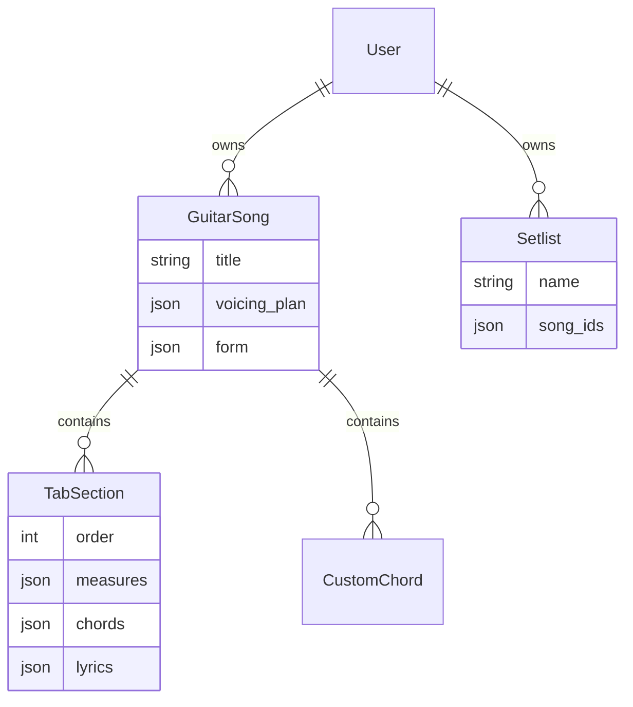

# 專案架構

服務架構圖放在 [README](../README.md#架構)。以下整理程式分工、資料關係，以及開發時會用到的服務。

## 程式分工

| 路徑 | 用途 |
| --- | --- |
| `frontend/App.tsx` | 路由、登入狀態、歌曲載入與頁面整合 |
| `frontend/components/` | 曲庫、創作、練習、編曲與和弦庫介面 |
| `frontend/hooks/` | 編輯、播放、認證與自動儲存 |
| `frontend/services/` | API、檔案、Drive 與指法規劃 |
| `frontend/music-theory/`、`frontend/guitar/` | 音樂理論、指板與指法產生 |
| `backend/core/` | Django 設定與根路由 |
| `backend/guitarflow/` | 模型、序列化器、權限、API 與測試 |
| `frontend/e2e/` | Playwright 瀏覽器測試 |

## 資料關係

`TabSection` 把音符、和弦和歌詞存成 JSON。`Setlist.song_ids` 記錄歌曲 ID 的順序，不是指向歌曲的外鍵。標準和弦另外存在唯讀的 `GlobalChord` 表。

- Docker 使用 PostgreSQL，資料保存在 `postgres_data` volume。
- 本機預設使用 `backend/db.sqlite3`；全域和弦表只由 PostgreSQL 初始化 SQL 建立。
- 歌曲以 `.gflow` 匯入匯出；Drive 的歌曲檔案由瀏覽器直接讀寫。
- 登入 token、主題與部分練習偏好保存在瀏覽器。

## 開發服務

| 服務 | Docker 主機位址 | 本機開發位址 |
| --- | --- | --- |
| 前端 | `127.0.0.1:3003` | `localhost:3000` |
| Django | `127.0.0.1:8000` | `localhost:8000` |
| 資料庫 | `127.0.0.1:5432` | SQLite |

前端預設呼叫同源的 `/api`，由 Vite 轉送。在 Docker 裡，目標是 `backend:8000`；本機則是 `localhost:8000`。要改轉送目標，設定 `API_PROXY_TARGET`；若要直接呼叫其他後端，則設定 `VITE_API_URL`。

Compose 會先等 PostgreSQL 通過健康檢查，再啟動 Django；等 `/api/global-chords/` 回應正常後，才啟動 Vite。Docker 對外提供的 port 預設綁在 loopback，本機 Vite 則監聽所有介面。

啟動和測試指令在 [README](../README.md)，API 與環境變數的設定在[後端開發](BACKEND_DEVELOP.md)。
