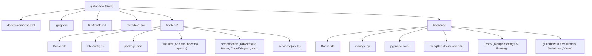

# GuitarFlow Studio Architecture & Structure Diagrams

This document contains visual diagrams mapping out the project's folder layout and its system architecture.

---

## 1. Directory Structure Chart

This graph visualizes the files and directories inside the restructured workspace.



---

## 2. Frontend & Backend System Architecture

This chart maps out how the browser clients interact with the Docker containers and how data flows through Django REST Framework down to SQLite.

```mermaid
sequenceDiagram
    autonumber
    actor User as Guitarist / Songwriter
    participant Browser as Browser UI (React SPA)
    participant Vite as Frontend Container (Port 3003)
    participant Django as Backend Container (Port 8000)
    database SQLite as SQLite DB (db.sqlite3)
    actor AdminUser as Administrator

    %% Frontend Assets loading
    User->>Browser: Access http://localhost:3003
    Browser->>Vite: Request assets
    Vite-->>Browser: Return React App bundle (JS/HTML/CSS)
    
    %% API data lifecycle
    Browser->>Django: GET /api/songs/ (fetch song list)
    Django->>SQLite: Query GuitarSong table (Django ORM)
    SQLite-->>Django: Return song records
    Django-->>Browser: Return JSON Song list
    
    %% Save lifecycle
    User->>Browser: Edit tab / Add section / Click Save
    Browser->>Django: PUT /api/songs/{id}/ (Send updated song JSON)
    Note over Django: serializers.py updates nested<br/>Sections & CustomChords
    Django->>SQLite: Delete old and insert new related records
    SQLite-->>Django: Confirm transaction
    Django-->>Browser: Return synchronized Song JSON
    
    %% Admin Control
    AdminUser->>Django: Access http://localhost:8000/admin/
    Django->>SQLite: Load/Edit tables (inlines supported)
    SQLite-->>Django: Persist updates
    Django-->>AdminUser: Render Django Admin Panel
```
